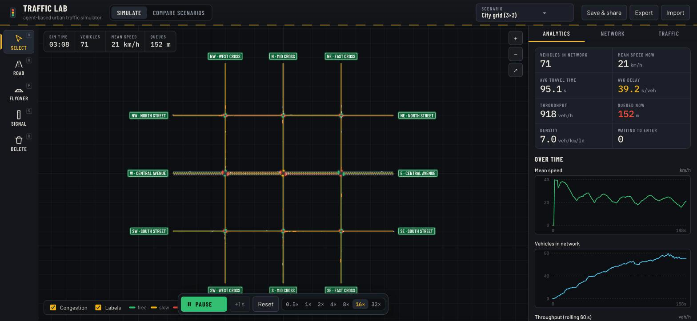

# Traffic Lab: an agent-based urban traffic simulator

Traffic Lab is a 2D top-down traffic simulator. You draw a road network, add traffic and signals, run an agent-based simulation, watch every vehicle move, and compare designs. A typical comparison is the same junction before and after adding a flyover.

Built for Project 2 of the QUEST Lab (IISc Bangalore) Full Stack AI pre-doctoral application.

**Live app:** https://quest-traffic-simulation.shashank-telkhade.workers.dev



---

## Contents

1. [Quick start](#1-quick-start)
2. [Using the app](#2-using-the-app)
3. [Running the tests](#3-running-the-tests)
4. [Deploying to Cloudflare](#4-deploying-to-cloudflare)
5. [Backend API](#5-backend-api)
6. [Architecture](#6-architecture)
7. [Simulation model](#7-simulation-model)
8. [Metrics](#8-metrics)
9. [Validation and results](#9-validation-and-results)
10. [Troubleshooting](#10-troubleshooting)
11. [Limitations and next steps](#11-limitations-and-next-steps)

---

## 1. Quick start

### Prerequisites

| Tool | Version | Check with |
| --- | --- | --- |
| Node.js | 22.18 or newer | `node -v` |
| npm | 10 or newer (comes with Node) | `npm -v` |
| Git | any recent version | `git --version` |

A Cloudflare account is only needed to deploy (step 4). Local development needs no account.

### Steps

```bash
# 1. Clone the repository
git clone https://github.com/shashank-100/quest-traffic-simulation.git
cd quest-traffic-simulation

# 2. Install dependencies
npm install

# 3. Start the app (frontend + backend API together)
npm run dev
```

Open **http://localhost:5173**. The dev server runs the React frontend and the Worker API on the same port, with a local, persistent stand-in for the KV store. Saving and sharing scenarios therefore works offline too.

To stop the server, press `Ctrl+C`.

### Other commands

| Command | What it does |
| --- | --- |
| `npm run dev` | Development server with hot reload (frontend + API) |
| `npm test` | Runs all 64 engine, validation and API tests once |
| `npm run test:watch` | Re-runs tests on every file change |
| `npm run build` | Type-checks everything, then builds for production |
| `npm run preview` | Serves the production build locally |
| `npm run deploy` | Runs the tests, then deploys to Cloudflare |

---

## 2. Using the app

### Watch a preset

1. Open the **Scenario** menu (top right) and pick a preset, for example *Signalised 4-way junction*.
2. Press **Play** (or `Space`). Use the speed buttons (0.5× to 32×) to speed up time.
3. Scroll to zoom and drag to pan. The **⤢** button fits the whole network on screen.
4. The **Analytics** tab shows live KPIs and charts. Road colours show congestion: green is free-flowing, amber slow, red jammed.
5. Press **Pause** to freeze, **+1 s** to step, and **Reset** to restart from t = 0 with the same seed.

| Preset | What it shows |
| --- | --- |
| Signalised 4-way junction | Two 4-lane arterials, mixed turning traffic, 2-phase signal |
| Crossing: at-grade (before) | A busy arterial meets a cross street at a signal |
| Crossing: flyover (after) | The same demand, with the arterial carried over on a flyover |
| Priority T-junction | Unsignalised junction served first come, first served |
| Lane-drop bottleneck | 3 lanes narrow to 2; zipper merging and queue build-up |
| City grid (3×3) | Nine signals, a green wave on the main avenue, congestion-aware routing |

### Build your own network

1. **Scenario → Blank canvas.**
2. Press `R` (Road tool). In the left rail, choose the lanes each way, one-way or not, and the speed limit.
3. Click to start a road and click again to end it. The tool keeps chaining from the last point; press `Esc` to stop.
   - Crossing an existing ground road **creates a 4-way junction automatically**.
   - Ending a road on another road **creates a T-junction**.
   - Loose ends become **entry/exit points** (green signs).
4. Press `F` (Flyover tool) and click two ground points at least 80 m apart. The flyover ramps up, crosses everything in between **without creating a junction**, then ramps down.
5. Press `S` (Signal tool) and click a junction to add a traffic signal.
6. Press `V` (Select tool) and click a road or junction to inspect and edit it:
   - **Road:** name, lanes in each direction, lane width, speed limit, and live speed, density and queue.
   - **Junction:** turn the signal on or off, set green time per phase, yellow, all-red and offset, and see live phase state and per-approach queues.
   - Drag a node to reshape the network. Press `Delete` to remove what's selected.
7. Open the **Traffic** tab and click **+ Add** to create flows. For each flow, set:
   - origin and destination (or "any exit");
   - entry rate in veh/h (Poisson arrivals);
   - vehicle mix: cars, two-wheelers, buses, trucks;
   - desired-speed factor, an optional vehicle cap, and a start time.

   The same tab holds the random **seed**, the **driving side** (left by default, as in India) and the **routing mode** (shortest path or congestion-aware).
8. Press **Play**.

Any edit rebuilds the network and restarts the simulation from t = 0, and a toast tells you so. `⌘Z` / `Ctrl+Z` undoes.

### Compare two scenarios

1. Click **Compare scenarios** in the top bar.
2. Choose **A** (baseline) and **B** (alternative). Either can be a preset or *Current*, the network you are editing.
3. Set the simulated time, the number of replications (seeds) and the first seed.
4. Click **Run comparison**. Both scenarios run headless in a background Web Worker with the same seeds. You get:
   - a headline result (average delay A → B);
   - a metrics table with mean ± standard deviation and the % change (green is better);
   - overlaid time-series charts.

### Save, share, export

- **Save & share** stores the scenario on the server and copies a link like `…/?s=abc123`. Anyone who opens the link gets the same network, demand and seed.
- **Export** downloads the scenario as JSON. **Import** loads a JSON file back in.

### Keyboard shortcuts

| Key | Action |
| --- | --- |
| `V` / `R` / `F` / `S` / `D` | Select / Road / Flyover / Signal / Delete tool |
| `Space` | Play / pause |
| `Esc` | Stop drawing, clear the selection |
| `Delete` | Delete the selected road or node |
| `⌘Z` / `Ctrl+Z` | Undo |

---

## 3. Running the tests

```bash
npm test
```

Expected output ends with `Tests  64 passed (64)` and takes about 3 seconds. The suites are in `tests/`:

| File | Covers |
| --- | --- |
| `vehicles.test.ts` | IDM fixed points, acceleration and speed bounds, trip time, car-following stops, mandatory and discretionary lane changes |
| `network.test.ts` | Lane counts and sides (left/right traffic), junction setbacks, turn-to-lane rules, conflicts, one-way roads, shortest paths |
| `junctions.test.ts` | For every preset: no conflicting movements inside a junction together, no overlaps, no starvation, no gridlock |
| `signals.test.ts` | Phase timing and offsets, one green phase at a time, no entry on red, queue discharge |
| `flyover.test.ts` | Ground crossings create junctions but flyovers don't; no turning onto the deck; elevation; before/after benefit |
| `metrics.test.ts` | Vehicle conservation, metric formulas, density, sampling, determinism, scenario validation |
| `validation.test.ts` | Capacity vs lane count and lane width; free-flow speed vs lane width; lane-drop merging; IIDM; ramp gradients; 30-minute multi-seed no-gridlock runs |
| `api.test.ts` | Save, list and load scenarios; invalid input; deterministic `/api/simulate` |

To type-check the whole project (frontend, engine, Worker and tests) without building:

```bash
npx tsc -b
```

---

## 4. Deploying to Cloudflare

The app deploys as **one Cloudflare Worker**: the built frontend is served as static assets, `/api/*` goes to the Worker code, and saved scenarios live in **Workers KV**. Configuration is in `cloudflare.config.ts` and uses the `cf` CLI (installed as a dev dependency).

1. **Sign in to Cloudflare** (once per machine):

   ```bash
   npx cf auth login
   npx cf auth whoami      # should print your account
   ```

   On a CI server or another machine without a browser, set an API token instead: `export CLOUDFLARE_API_TOKEN=...`.

2. **Optional:** change the Worker name. It decides the URL `https://<name>.<your-subdomain>.workers.dev`. Edit `name` in `cloudflare.config.ts`.

3. **Deploy:**

   ```bash
   npm run deploy
   ```

   This runs the test suite and then `cf deploy`, which builds the app and uploads it. On the first deploy it also **creates the KV namespace automatically** for the `SCENARIOS` binding. No manual setup is needed.

4. **Check the deployment.** The deploy prints the URL. Then run:

   ```bash
   curl https://<your-worker-url>/api/health
   # {"ok":true,"engine":"agent-based IDM/MOBIL",...}
   ```

To see live request logs: `npx wrangler tail quest-traffic-simulation`.

---

## 5. Backend API

All endpoints return JSON. Scenario bodies are validated (shape, value ranges, a 512 KB size limit) before anything is stored or run.

| Method | Path | Body | Returns |
| --- | --- | --- | --- |
| `GET` | `/api/health` | none | `{ ok, engine, time }` |
| `POST` | `/api/scenarios` | Scenario JSON | `201 { id, name, createdAt }` |
| `GET` | `/api/scenarios` | none | `{ scenarios: [{ id, name, createdAt }] }` (30 most recent) |
| `GET` | `/api/scenarios/:id` | none | Scenario JSON, or `404` |
| `POST` | `/api/simulate` | `{ scenario, duration?, seed? }` | `{ summary, samples, warnings, duration, seed }` |

`/api/simulate` runs the same engine as the browser, headless on the server. It is capped at 600 simulated seconds per request. Example, using a scenario exported from the app as `my-scenario.json`:

```bash
curl -X POST https://quest-traffic-simulation.shashank-telkhade.workers.dev/api/simulate \
  -H 'content-type: application/json' \
  -d "{\"scenario\": $(cat my-scenario.json), \"duration\": 300, \"seed\": 7}"
```

The same scenario and seed always return the same `summary`.

---

## 6. Architecture

```
src/
├── engine/        Pure TypeScript simulation engine: no DOM, no timers, deterministic
│   ├── types.ts       Serializable Scenario model (network + signals + demand + seed)
│   ├── network.ts     Compiles a scenario into edges, lanes, junction connectors, conflict sets
│   ├── editor.ts      Pure editing operations (auto-junctions, flyovers, splits, deletes)
│   ├── simulation.ts  Agent loop: spawning, IDM, junction control, MOBIL, metrics
│   ├── vehicles.ts    Per-type IDM parameters (car, bus, two-wheeler, truck)
│   ├── signals.ts     Fixed-time signal plans, automatic phase grouping
│   ├── routing.ts     Dijkstra over directed edges, reachability
│   ├── schema.ts      Validation of untrusted scenario JSON (imports, API)
│   └── presets.ts     Reproducible demo and test scenarios
├── web/           React frontend: renders engine state, never moves vehicles itself
│   ├── App.tsx        Layout, scenario state, undo, save/share
│   ├── MapView.tsx    Canvas, editor tools, fixed-step simulation loop
│   ├── renderer.ts    Canvas drawing (roads, decks, signals, vehicles, overlays)
│   ├── Inspector.tsx, TrafficPanel.tsx, Analytics.tsx, Compare.tsx
│   └── compare.worker.ts  Headless runs for scenario comparison (Web Worker)
└── worker/
    └── index.ts   Cloudflare Worker API (KV storage + headless simulation)
tests/             Vitest suites
cloudflare.config.ts   Worker, static assets and KV binding
```

**Separation of simulation and rendering.** The engine advances in fixed 0.1 s steps. The browser only decides how many steps to run per animation frame (the speed multiplier) and then draws the vehicle poses the engine computed. No motion is interpolated or animated in the frontend. One function, `runScenario()`, powers the tests, the comparison worker and the server API.

**Tech stack:** TypeScript, React 19, Vite 8, Canvas 2D, Vitest, Cloudflare Workers + Workers KV. There are no runtime dependencies beyond React.

---

## 7. Simulation model

- **Network compilation.** Each road direction becomes an *edge* with one *lane* per lane count. Lanes are offset to the driving side; left-hand traffic is the default and can be changed. Lanes stop short of junctions by a setback based on road widths and approach angles. Junctions get *connectors*: Bézier movements from incoming to outgoing lanes, with no U-turns. Lane-use rules: kerb-side turns leave from the outer lane, far-side turns from the inner lane, and through movements from any lane.
- **Crossing conflicts and merges.** Movements whose swept paths cross (or pass within 2 m) are *crossing conflicts* and are never inside the junction together. Movements that converge into the same exit lane without crossing are *merges*. They are served by gap acceptance: a vehicle may enter when, projected onto the shared exit lane, it is either behind the merging traffic by at least its standstill gap or ahead of it with room for that traffic to keep following. Approaching vehicles also follow merging traffic from the neighbouring movement, so a lane drop works as a zipper rather than one vehicle at a time.
- **Flyovers.** Nodes have a level (ground or elevated), and roads only connect at shared nodes. The editor only splits roads on the same level. A deck crossing a ground road therefore has no connector with it, no conflict and no false intersection. Ramps climb to a 6 m deck height, and a climbing vehicle's available acceleration drops by g·sinθ, so loaded trucks and buses visibly struggle up the ramps.
- **Lane width.** Width changes driving behaviour, not just the drawing. Each lane is converted to an *equivalent car lane width*: the same side clearance a 1.8 m car would have. A 2.5 m bus in a 3.5 m lane therefore behaves like a car in a 2.8 m lane, while a two-wheeler is unaffected.
  - Desired speed follows the HCM free-flow-speed lane-width adjustment: no change at 3.6 m or wider, −3% at 3.3 m, −10% at 3.0 m, extrapolated down to a 70% floor.
  - Desired time headway is divided by the HCM saturation-flow lane-width factor f_w = 1 + (W − 3.6)/9.
- **Lane count.** Each lane is an independent queue with its own car-following, so capacity adds up across lanes. Approach lanes are assigned to turns, and lane changes let vehicles use spare lanes.
- **Car following.** The Intelligent Driver Model (Treiber, Hennecke & Helbing, 2000). Above its desired speed (for example, entering a slower or narrower road) a vehicle uses the improved IDM free-road term (Treiber & Kesting, 2013), so it slows at the comfortable deceleration instead of braking hard. The leader is found along the vehicle's own path, across segment boundaries. Red lights, ungranted junctions and wrong-lane lane ends act as virtual stopped obstacles. Vehicles slow for tight turns.
- **Junction control.** Vehicles near a stop line request their movement. A vehicle may only hold permission to enter while every vehicle ahead of it in its lane holds it too; permissions behind a vehicle that has to wait are withdrawn. Without this, stale permissions could lock a junction for good. Requests are served first come, first served, subject to:
  - the signal (red: wait; yellow: go only if unable to stop comfortably);
  - no crossing conflict with movements already granted or occupied, and gap acceptance against merging traffic;
  - room on the exit lane (no blocking the box).

  A blocked earlier request reserves its movement, which prevents starvation.
- **Lane changes.** MOBIL (Kesting, Treiber & Helbing, 2007) with politeness and safe-braking checks. Mandatory changes move vehicles into a lane that serves their next turn. A vehicle that still misses its lane re-routes from where it is.
- **Entering the network.** A new vehicle enters as if arriving from upstream: at the leader's speed with an equilibrium gap, or creeping into a queue that has backed up to the entry. Entry therefore doesn't cap road capacity.
- **Demand and routing.** Arrivals are seeded Poisson. Each driver's desired speed comes from the vehicle type, the flow factor and a personal N(1, 0.08) multiplier. Routes use the shortest free-flow time or, optionally, an exponentially smoothed estimate of observed travel time on each edge.
- **Determinism.** All randomness goes through one seeded PRNG (mulberry32), and agents update in a fixed order. The same scenario and seed give bit-identical results.

---

## 8. Metrics

| Metric | Definition |
| --- | --- |
| Travel time | Network entry → exit, averaged over completed trips |
| Delay | Travel time minus free-flow time at the driver's desired speed |
| Trip speed | Total distance ÷ total travel time over completed trips |
| Throughput | Completed trips per hour (overall); also a rolling 60 s rate |
| Queue length | Per approach lane: the stopped (< 2 m/s) platoon contiguous with the stop line, in metres |
| Density | Vehicles per km per lane, per link and network-wide |
| Time stopped | Share of vehicle-time spent below 0.5 m/s |

---

## 9. Validation and results

### Capacity and lane geometry

Measured with `tests/validation.test.ts`: cars only, an oversaturated straight one-way road, 10-minute window.

| Lanes | Lane width | Discharge | Free-flow trip speed (mixed traffic, 300 veh/h) |
| --- | --- | --- | --- |
| 1 | 3.5 m | 1,644 veh/h | 48.8 km/h |
| 2 | 3.5 m | 3,288 veh/h | — |
| 3 | 3.5 m | 4,932 veh/h | — |
| 1 | 2.75 m | 1,488 veh/h | 39.6 km/h |
| 1 | 3.0 m | 1,548 veh/h | 42.2 km/h |
| 1 | 4.0 m | 1,704 veh/h | 53.1 km/h |

- **Lane count:** capacity scales almost exactly with the number of lanes.
- **Lane width:** capacity and speed both rise with width.
- **Signals:** discharge from a signal is about 1,440 veh/h of green per lane, close to the saturation flows reported for Indian urban junctions.
- **Lane drop:** the 3→2 lane-drop preset discharges about 2,670 veh/h, roughly 80% of two free lanes. This matches the capacity drop observed at real merges.

### Safety and robustness

All six presets were run for 30 simulated minutes on 3 seeds each. In every run:
- no two crossing movements were ever inside a junction together;
- merging vehicles never overlapped;
- no vehicle held permission to enter behind a waiting vehicle;
- no vehicles overlapped;
- **zero safety interventions:** the hard non-overlap clamp never had to act;
- no gridlock.

### Before vs after a flyover

Built into the Compare view. Same demand: 2,100 veh/h on the arterial and 840 veh/h on the cross street. 15 simulated minutes, seeds 42–44:

| | At-grade signal | Flyover | Change |
| --- | --- | --- | --- |
| Average delay | 26.9 ± 4.9 s | 5.8 ± 0.6 s | −78% |
| Average travel time | 86.2 s | 66.3 s | −23% |
| Average trip speed | 31.3 km/h | 40.4 km/h | +29% |
| Average total queue | 55.5 m | 0 m | −100% |
| Throughput | 2,601 veh/h | 2,717 veh/h | +4% |

The flyover removes the signal delay and queues. The delay that remains comes from car-following and heavy vehicles slowing on the ramps.

--- | --- | --- |
| Average delay | 22.9 ± 1.8 s | 4.3 ± 0.3 s (−81%) |
| Average travel time | 80.3 s | 62.7 s (−22%) |
| Average trip speed | 33.5 km/h | 42.7 km/h (+27%) |
| Average total queue | 48.6 m | 0 m |

Throughput is essentially unchanged (+1%) because demand is below capacity in both designs. The flyover removes delay and queues rather than adding capacity.

---

## 10. Troubleshooting

| Problem | Fix |
| --- | --- |
| `npm install` warns that `workerd` install scripts were skipped | Run `npm install-scripts approve workerd`, then `npm install` again. `npm run dev` needs the `workerd` binary. |
| `Cannot use import statement outside a module` | Use Node 22.18+ and keep `"type": "module"` in `package.json`. |
| Port 5173 already in use | `npx cf dev --port 5180` |
| "Save & share" fails locally | Start the app with `npm run dev`, not `vite` alone; the API runs inside the Cloudflare dev server. |
| `cf deploy` asks you to sign in | Run `npx cf auth login`, or set `CLOUDFLARE_API_TOKEN`. |
| The simulation restarted unexpectedly | Any edit to the network, traffic or signals rebuilds the simulation from t = 0 so results stay reproducible. |

---

## 11. Limitations and next steps

- Signals are fixed-time. Actuated or adaptive control, such as max-pressure, would plug into `lightFor` in `signals.ts`.
- Lane width changes signal discharge by only about 1% between 3.0 and 3.5 m, against about 7% in the HCM. Discharge from a standing queue is limited mainly by acceleration, which width doesn't change in this model.
- Unsignalised junctions are first come, first served. There are no major/minor road priority rules.
- Ramp gradients reduce acceleration but not sustained speed; a power-limited climbing model would add that.
- Roads are straight segments between nodes; draw a curve as a chain of segments.
- Two-wheelers keep lane discipline. Lane filtering, common in Indian traffic, is not modelled.
- There is one elevated level, so two decks crossing each other create a junction on the deck.
